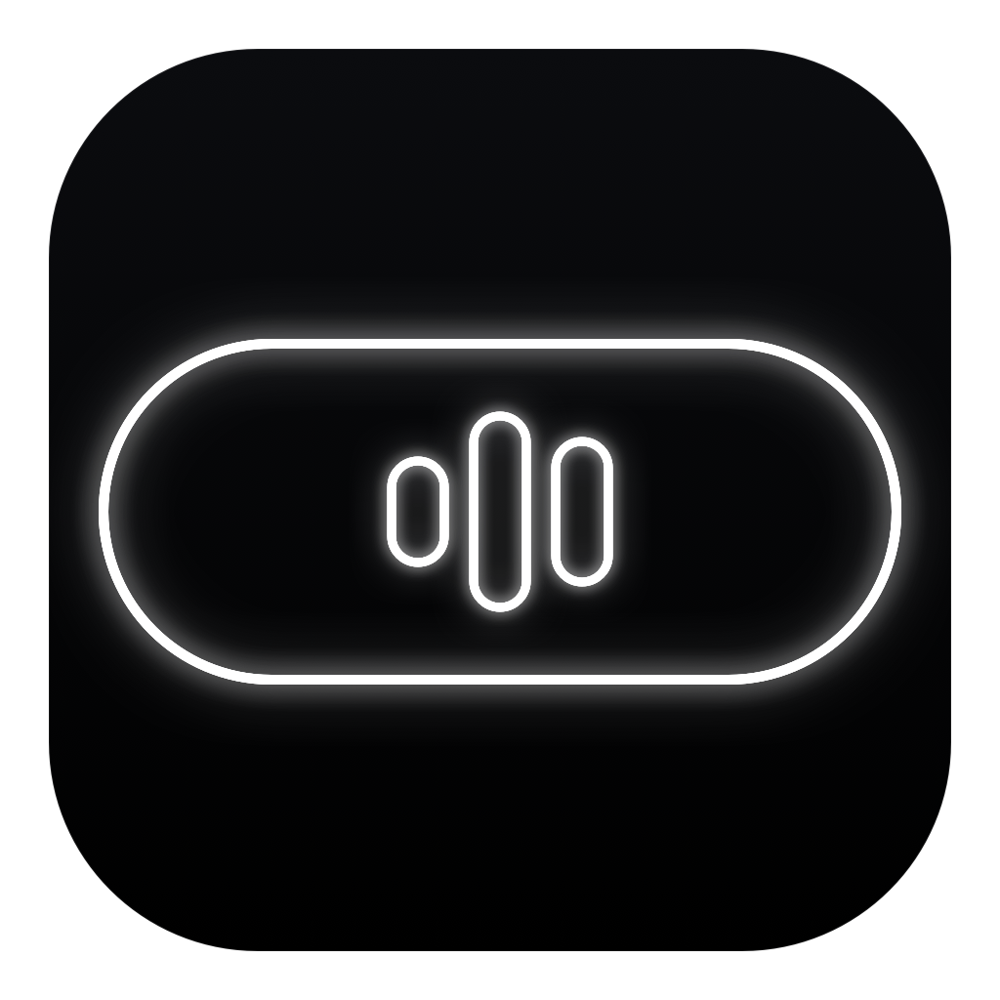

# Isla



Isla is an open-source macOS menu bar "dynamic island": a compact capsule that expands into a panel for now playing, lyrics, Pomodoro, network speed, clipboard, file shelf and plugins.

- Native Swift / AppKit / SwiftUI; no Electron, low idle CPU
- Three forms: **Centered curtain** (occupies a real menu bar slot, fixed, never covers other icons), **Menu bar capsule** (floating, draggable along the menu bar), **Edge rail**
- Multi-display, bilingual UI, plugin system with an Ed25519-signed store
- In-app update: check, download the DMG, or update and restart directly

MIT License. Issues and PRs are welcome.

## Install

Download the latest DMG from [GitHub Releases](https://github.com/LLllCCC/Isla/releases/latest), drag `Isla.app` into Applications, then open it.

The app is currently self-signed and not notarized. If Gatekeeper blocks the first launch, open **System Settings → Privacy & Security** and click **Open Anyway** (macOS 15+ no longer has the old right-click bypass). Grant Accessibility when prompted; without it the capsule falls back to the screen centre and play/pause detection is slower.

Requires macOS 14+.

## Updates

Settings → About → Check for Updates, or the menu bar menu:

- **Update and Restart**: downloads a ZIP, verifies SHA-256 + Ed25519 signature + code signature, replaces the app and relaunches.
- **Download Installer**: downloads the DMG to Downloads.
- Automatic check runs at launch and every 24 hours; installation always asks for confirmation.

Updates use the same self-signed certificate, so Accessibility permission, login item, settings and plugin data are preserved.

## Build from source

Command Line Tools are enough; Xcode is not required:

```bash
xcode-select --install
./build.sh
open build/Isla.app
```

Install to `/Applications` and register the login item:

```bash
./install.sh
```

## Plugins

- [Plugin guide](docs/PLUGIN-DEV.md)
- [Plugin architecture](docs/PLUGIN-ARCHITECTURE.md)
- [Template](docs/plugin-template/)
- Samples: [clipboard-board](Samples/clipboard-board), [web-dashboard](Samples/web-dashboard)

The plugin store index is signed with Ed25519. Signing proves the index source, not that plugin code is audited; Isla still asks for each permission at install time.

## Security

- Clipboard, shelf, playback and Pomodoro data stay on the device; no telemetry.
- App updates are HTTPS-only, use a pinned Ed25519 appcast key, verify SHA-256 and the code-signing certificate, and reject build downgrades / expired appcasts.
- See [SECURITY.md](SECURITY.md) and [docs/RELEASE.md](docs/RELEASE.md).

## Limitations

- Self-signed and not notarized: the first launch needs manual approval.
- The Centered curtain occupies a menu bar slot; its position is controlled by macOS and is not necessarily the geometric screen centre.
- On macOS 27 the status item window coordinates are often unreadable, so the slot is derived via AX scanning (first launch may need 2–3 seconds to settle).

## Contact

Questions, suggestions and security reports: [abuse@yopo.ccwu.cc](mailto:abuse@yopo.ccwu.cc). Issues and PRs are also welcome on GitHub.

## License

[MIT](LICENSE)
