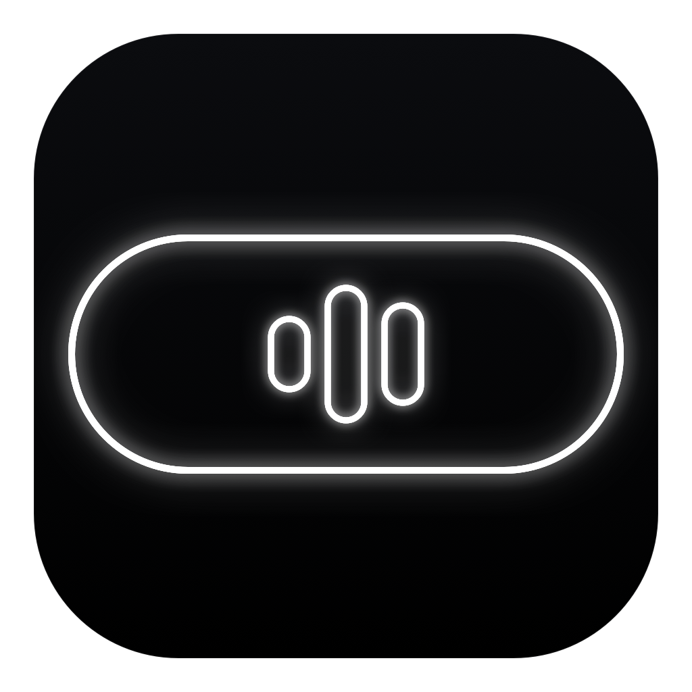

# Isla



Isla 是一个 macOS 菜单栏「灵动岛」：把正在播放、歌词、番茄钟、网速、时间、剪贴板、文件暂存和插件内容收进一个可展开的胶囊面板。

> English: [README.en.md](README.en.md)

- 原生 Swift / AppKit / SwiftUI，无 Electron，空闲 CPU 很低
- 三种形态：**居中垂帘**（占一个真实菜单栏槽位、固定不可拖，不盖其它图标）、**菜单栏胶囊**（浮层，可左右拖到菜单栏任意位置）、**边缘细线**
- 悬停展开面板；媒体、歌词、番茄钟、网速、剪贴板、文件暂存、插件卡片
- 多显示器：主屏 / 跟随鼠标 / 指定屏
- 中英文界面；插件体系 + Ed25519 签名商店
- App 内更新：检查更新、下载安装包、直接更新并重启

MIT License。欢迎提交 issue / PR。

## 下载安装

从 [GitHub Releases](https://github.com/LLllCCC/Isla/releases/latest) 下载最新 DMG：

1. 把 `Isla.app` 拖进「应用程序」。
2. 首次打开：当前是自签、未公证版本。若被 Gatekeeper 拦截，打开
   「系统设置 → 隐私与安全性」，点「仍要打开」；macOS 15+ 没有旧版右键打开的绕过。
3. 首次运行按提示授予「辅助功能」权限。授权后胶囊会避开其它菜单栏图标，播放/暂停判定也更即时；不授权也能用。

系统要求：macOS 14+。

## 更新

设置 → 关于 → 检查更新，或菜单栏图标菜单 → 检查更新…：

- **直接更新并重启**：App 内下载 ZIP，校验 SHA-256 + Ed25519 签名 + 代码签名后替换 App，自动重启。
- **下载安装包**：把 DMG 下载到「下载」文件夹，自己拖进「应用程序」覆盖。
- 支持启动后每 24 小时自动检查；安装前仍会确认，不会静默替换。

更新使用同一张自签证书签名，辅助功能授权、登录项、设置和插件数据会保留。

## 从源码构建

只需要 Command Line Tools，不需要 Xcode：

```bash
xcode-select --install
./build.sh
open build/Isla.app
```

安装到 `/Applications` 并注册登录项：

```bash
./install.sh
```

构建脚本会用本机的 `Isla Self Signed` 证书签名（没有则回退 ad-hoc）；ad-hoc 构建每次 cdhash 变化，辅助功能授权可能需要重新授予。

## 使用

- 悬停胶囊展开面板；点击胶囊展开/钉住；菜单栏三竖条图标打开常用菜单。
- 设置 → 胶囊 → 形态：
  - **居中垂帘**：占一个真实状态项槽位，固定不可拖，不会压住其它菜单栏图标。
  - **菜单栏胶囊**：纯浮层，直接左右拖动；可能盖住该位置的其它图标。
- 设置 → 关于：版本号、检查更新、自动检查开关。
- 插件：设置 → 插件 → 插件商店（远端），默认源 `https://llllccc.github.io/Isla/index.json`。

快捷键：`⌥⌘Space` 唤出/收起面板，`⌘,` 打开设置。

## 插件

- 开发指南：[docs/PLUGIN-DEV.md](docs/PLUGIN-DEV.md)
- 架构：[docs/PLUGIN-ARCHITECTURE.md](docs/PLUGIN-ARCHITECTURE.md)
- 模板：[docs/plugin-template/](docs/plugin-template/)
- 示例：[Samples/clipboard-board](Samples/clipboard-board)、[Samples/web-dashboard](Samples/web-dashboard)

插件商店索引使用 Ed25519 发布者签名；签名只证明索引来源，不代表插件代码审计。安装时 Isla 会逐项确认权限。

## 安全与隐私

- 剪贴板、暂存架、播放信息、番茄钟统计都在本机处理；没有遥测。
- 插件只能拿到 manifest 声明的权限，安装/更新时逐项确认。
- App 更新源只允许 HTTPS；appcast 公钥固定在二进制内，更新包还要通过 SHA-256、bundle id、版本/build 和代码签名（含自签证书叶哈希）校验。
- 发布流程与 secrets 说明见 [docs/RELEASE.md](docs/RELEASE.md)。

## 已知限制

- 自签、未公证：首次安装需要手动允许；没有 Apple Developer ID。
- 「居中垂帘」占一个状态项槽位，位置由系统菜单栏排布决定，不一定是屏幕几何中心。
- macOS 27 上系统状态项窗口坐标常常不可读，槽位靠 AX 扫描反推，首次启动可能需要 2–3 秒校正。
- 插件安装会修改 `~/Library/Application Support/Isla`；卸载时可一并删除。

## 联系

问题、建议或安全问题都可以发送至 [abuse@yopo.ccwu.cc](mailto:abuse@yopo.ccwu.cc)，也欢迎在 GitHub 提 issue / PR。

## 结构

```
Sources/Isla/                 App 主程序（AppKit + SwiftUI）
Sources/IslaPluginHost/       插件 JS 宿主
Resources/                    图标、Info.plist、英文词表、更新助手脚本
Samples/                      内置示例插件
store/                        插件商店静态源（index.json + 签名 + packages）
site/                         GitHub Pages 落地页
tools/                        构建、签名、自检、模拟器
docs/                         插件开发、架构、发布文档
```

## 致谢

设计参考了 macOS 菜单栏、Dynamic Island 以及多个开源菜单栏工具的思路；实现与图标均为本项目所有。

## License

[MIT](LICENSE)
